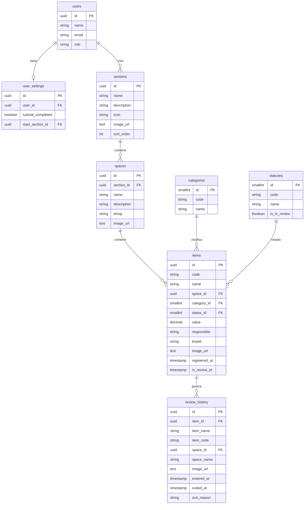

# API de Inventario — Especificación del módulo

Documento de referencia para implementar el módulo de inventario dentro de una API existente. Todos los endpoints están en inglés. Los nombres de tablas, columnas y campos JSON también están en inglés; los valores visibles para el usuario (nombres de categorías, estados y motivos) se mantienen en español para que la app los muestre sin traducción adicional.

---

## 1. Resumen

La app gestiona un inventario jerárquico:

```
Section (apartado)
  └── Space (espacio / sala)
        └── Item (objeto / activo)
              └── ReviewHistory (registro de revisión)
```

Además maneja:

- Configuración por usuario (tutorial completado y sección de inicio).
- Catálogos de categorías y estados.
- Métricas agregadas.
- Imágenes por URL (subida multipart).

El módulo debe reutilizar el sistema de autenticación, la tabla de usuarios y los roles ya existentes en la API. No se debe crear un nuevo login.

---

## 2. Alcance y supuestos

- **Prefijo base:** `/api/v1/inventory` (configurable).
- **Autenticación:** JWT (o el mecanismo existente) vía `Authorization: Bearer <token>`.
- **Usuarios:** tabla existente `users` con roles `ADMIN`, `SUPERVISOR`, `COLABORADOR`.
- **Inventario compartido:** todos los usuarios autorizados ven el mismo inventario. Los campos `created_by` / `updated_by` son solo de auditoría; no filtran datos.
- **Base de datos:** motor desconocido. El anexo DDL usa SQL portable con notas para PostgreSQL, MySQL y SQLite.
- **IDs:** UUID generados por el servidor. Si la API existente usa `BIGINT`, reemplazar el tipo sin cambiar el contrato.
- **Fechas:** ISO-8601 en UTC, por ejemplo `2026-11-13T15:30:00Z`.
- **Imágenes:** la API recibe archivos por multipart y devuelve una URL pública. La app guarda `imageUrl`, no rutas locales.
- **La data de demostración del tutorial** (apartado/espacio/objeto de ejemplo) es solo del cliente y no debe persistirse en la API.

---

## 3. Convenciones de la API

### 3.1 Formato de respuesta

Respuesta de un recurso:

```json
{
  "data": { }
}
```

Respuesta de una lista:

```json
{
  "data": [],
  "meta": {
    "page": 1,
    "limit": 20,
    "total": 42
  }
}
```

Respuesta de error:

```json
{
  "error": {
    "code": "DUPLICATE_CODE",
    "message": "Ya existe un objeto con el código ACT-001.",
    "details": [
      { "field": "code", "value": "ACT-001" }
    ]
  }
}
```

### 3.2 Paginación

- Query params: `page` (default `1`), `limit` (default `20`, máximo `100`).
- Las listas sin paginación explícita (catálogos, secciones) pueden devolver todos los registros.

### 3.3 Fechas y números

- Fechas en UTC con formato ISO-8601.
- Valores monetarios como número decimal (`1200.50`), nunca como string.

### 3.4 Códigos de estado HTTP

| Código | Uso |
| --- | --- |
| 200 | Consulta o actualización exitosa |
| 201 | Recurso creado |
| 204 | Eliminación exitosa sin cuerpo |
| 400 | Datos inválidos |
| 401 | Token ausente o inválido |
| 403 | Rol sin permiso |
| 404 | Recurso no encontrado |
| 409 | Conflicto (código duplicado, transferencia inválida, revisión activa) |
| 413 | Archivo demasiado grande |
| 415 | Tipo de archivo no permitido |
| 500 | Error interno |

---

## 4. Autenticación y autorización

### 4.1 Matriz de permisos

| Grupo de endpoints | COLABORADOR | SUPERVISOR | ADMIN |
| --- | --- | --- | --- |
| `GET /settings`, `GET /catalogs` | 403 | Permitido | Permitido |
| `GET /sections`, `GET /spaces`, `GET /items`, `GET /history/*`, `GET /metrics` | 403 | Permitido | Permitido |
| `POST/PATCH/PUT/DELETE` de cualquier recurso | 403 | 403 | Permitido |
| `POST /uploads/images`, `DELETE /uploads/images` | 403 | 403 | Permitido |

Reglas:

- `COLABORADOR` no puede acceder a ningún endpoint del módulo: responder `403 FORBIDDEN`.
- `SUPERVISOR` solo puede leer (`GET`).
- `ADMIN` puede leer y escribir.
- El middleware de autorización debe ejecutarse antes de resolver el recurso.

### 4.2 Usuario autenticado

El token debe exponer al menos:

- `userId`
- `role` (`ADMIN`, `SUPERVISOR`, `COLABORADOR`)

Usar `userId` para llenar `created_by` y `updated_by`.

---

## 5. Modelo de datos

### 5.1 Diagrama entidad-relación



### 5.2 Tablas

#### `users` (existente, solo referencia)

| Columna | Tipo | Restricciones | Descripción |
| --- | --- | --- | --- |
| `id` | UUID | PK | Usuario existente |
| `name` | VARCHAR(120) | NOT NULL | Nombre |
| `email` | VARCHAR(180) | UNIQUE, NOT NULL | Correo |
| `role` | VARCHAR(20) | NOT NULL | `ADMIN`, `SUPERVISOR`, `COLABORADOR` |

> No crear esta tabla si ya existe. Solo se referencia por FK.

#### `user_settings`

| Columna | Tipo | Restricciones | Descripción |
| --- | --- | --- | --- |
| `id` | UUID | PK | Identificador |
| `user_id` | UUID | UNIQUE, NOT NULL, FK `users(id)` ON DELETE CASCADE | Usuario |
| `tutorial_completed` | BOOLEAN | NOT NULL DEFAULT FALSE | Tutorial completado |
| `start_section_id` | UUID | NULL, FK `sections(id)` ON DELETE SET NULL | Sección inicial en Inicio |
| `created_at` | TIMESTAMP | NOT NULL DEFAULT now | Creación |
| `updated_at` | TIMESTAMP | NOT NULL DEFAULT now | Actualización |

#### `sections` (apartados)

| Columna | Tipo | Restricciones | Descripción |
| --- | --- | --- | --- |
| `id` | UUID | PK | Identificador |
| `name` | VARCHAR(120) | NOT NULL | Nombre del apartado |
| `description` | VARCHAR(255) | NOT NULL DEFAULT '' | Descripción breve |
| `icon` | VARCHAR(16) | NOT NULL DEFAULT '🏢' | Emoji o icono |
| `image_url` | TEXT | NULL | Imagen del apartado |
| `sort_order` | INT | NOT NULL DEFAULT 0 | Orden en Inicio y listado |
| `created_by` | UUID | NULL, FK `users(id)` | Auditoría |
| `updated_by` | UUID | NULL, FK `users(id)` | Auditoría |
| `created_at` | TIMESTAMP | NOT NULL DEFAULT now | Creación |
| `updated_at` | TIMESTAMP | NOT NULL DEFAULT now | Actualización |

#### `spaces` (espacios / salas)

| Columna | Tipo | Restricciones | Descripción |
| --- | --- | --- | --- |
| `id` | UUID | PK | Identificador |
| `section_id` | UUID | NOT NULL, FK `sections(id)` ON DELETE CASCADE | Apartado padre |
| `parent_space_id` | UUID | NULL, FK `spaces(id)` ON DELETE CASCADE | Espacio padre (subespacios, profundidad ilimitada) |
| `name` | VARCHAR(120) | NOT NULL | Nombre del espacio |
| `description` | VARCHAR(255) | NOT NULL DEFAULT '' | Descripción breve |
| `emoji` | VARCHAR(16) | NOT NULL DEFAULT '🏢' | Emoji |
| `image_url` | TEXT | NULL | Imagen del espacio |
| `created_by` | UUID | NULL, FK `users(id)` | Auditoría |
| `updated_by` | UUID | NULL, FK `users(id)` | Auditoría |
| `created_at` | TIMESTAMP | NOT NULL DEFAULT now | Creación |
| `updated_at` | TIMESTAMP | NOT NULL DEFAULT now | Actualización |

#### `items` (objetos / activos)

| Columna | Tipo | Restricciones | Descripción |
| --- | --- | --- | --- |
| `id` | UUID | PK | Identificador |
| `code` | VARCHAR(50) | NOT NULL | Placa o código único (case-insensitive) |
| `name` | VARCHAR(150) | NOT NULL | Nombre del objeto |
| `space_id` | UUID | NOT NULL, FK `spaces(id)` ON DELETE CASCADE | Espacio actual |
| `category_id` | SMALLINT | NOT NULL, FK `categories(id)` | Categoría |
| `status_id` | SMALLINT | NOT NULL, FK `statuses(id)` | Estado |
| `value` | DECIMAL(12,2) | NOT NULL DEFAULT 0, CHECK `value >= 0` | Valor estimado |
| `responsible` | VARCHAR(120) | NOT NULL DEFAULT 'Sin asignar' | Responsable |
| `brand` | VARCHAR(120) | NOT NULL DEFAULT '' | Marca |
| `image_url` | TEXT | NULL | Imagen del objeto |
| `registered_at` | TIMESTAMP | NOT NULL DEFAULT now | Fecha de registro |
| `in_review_at` | TIMESTAMP | NULL | Última entrada a revisión |
| `created_by` | UUID | NULL, FK `users(id)` | Auditoría |
| `updated_by` | UUID | NULL, FK `users(id)` | Auditoría |
| `created_at` | TIMESTAMP | NOT NULL DEFAULT now | Creación |
| `updated_at` | TIMESTAMP | NOT NULL DEFAULT now | Actualización |

Índice único: `UNIQUE (LOWER(code))`.

#### `review_history` (historial de revisiones)

| Columna | Tipo | Restricciones | Descripción |
| --- | --- | --- | --- |
| `id` | UUID | PK | Identificador |
| `item_id` | UUID | NULL, FK `items(id)` ON DELETE SET NULL | Objeto (se conserva el historial si se elimina) |
| `item_name` | VARCHAR(150) | NOT NULL | Snapshot del nombre |
| `item_code` | VARCHAR(50) | NOT NULL | Snapshot del código |
| `space_id` | UUID | NULL, FK `spaces(id)` ON DELETE SET NULL | Espacio al entrar |
| `space_name` | VARCHAR(120) | NULL | Snapshot del nombre del espacio |
| `image_url` | TEXT | NULL | Snapshot de la imagen |
| `entered_at` | TIMESTAMP | NOT NULL | Fecha de entrada |
| `exited_at` | TIMESTAMP | NULL | Fecha de salida (`NULL` = activa) |
| `exit_reason` | VARCHAR(255) | NULL | Motivo de salida |
| `created_at` | TIMESTAMP | NOT NULL DEFAULT now | Creación |
| `updated_at` | TIMESTAMP | NOT NULL DEFAULT now | Actualización |

Regla: un objeto solo puede tener **una revisión activa** (`exited_at IS NULL`).

#### `categories` (catálogo)

| Columna | Tipo | Restricciones |
| --- | --- | --- |
| `id` | SMALLINT | PK |
| `code` | VARCHAR(40) | UNIQUE, NOT NULL |
| `name` | VARCHAR(80) | NOT NULL |
| `sort_order` | INT | NOT NULL DEFAULT 0 |

#### `statuses` (catálogo)

| Columna | Tipo | Restricciones |
| --- | --- | --- |
| `id` | SMALLINT | PK |
| `code` | VARCHAR(40) | UNIQUE, NOT NULL |
| `name` | VARCHAR(80) | NOT NULL |
| `is_in_review` | BOOLEAN | NOT NULL DEFAULT FALSE |
| `sort_order` | INT | NOT NULL DEFAULT 0 |

### 5.3 Catálogos iniciales

Categorías:

| id | code | name |
| --- | --- | --- |
| 1 | `general` | General |
| 2 | `it_computing` | Cómputo & IT |
| 3 | `electronics` | Electrónica |
| 4 | `furniture` | Mobiliario |
| 5 | `audiovisual` | Audiovisual |
| 6 | `audio` | Audio |
| 7 | `gaming` | Gaming |
| 8 | `clothing` | Ropa |
| 9 | `collection` | Colección |
| 10 | `supplies` | Insumos |
| 11 | `consumables` | Suministros |

Estados:

| id | code | name | is_in_review |
| --- | --- | --- | --- |
| 1 | `excellent` | Excelente | false |
| 2 | `good` | Bueno | false |
| 3 | `operational` | Operativo | false |
| 4 | `in_use` | En uso | false |
| 5 | `in_review` | En revisión | true |
| 6 | `damaged` | Dañado | false |

### 5.4 Índices recomendados

```sql
CREATE INDEX ix_spaces_section ON spaces (section_id);
CREATE INDEX ix_items_space ON items (space_id);
CREATE INDEX ix_items_category ON items (category_id);
CREATE INDEX ix_items_status ON items (status_id);
CREATE INDEX ix_items_brand ON items (brand);
CREATE INDEX ix_items_value ON items (value);
CREATE INDEX ix_items_registered ON items (registered_at);
CREATE INDEX ix_items_name ON items (name);
CREATE INDEX ix_review_item ON review_history (item_id);
CREATE INDEX ix_review_entered ON review_history (entered_at);
CREATE INDEX ix_review_exited ON review_history (exited_at);
CREATE INDEX ix_sections_order ON sections (sort_order);
```

---

## 6. Reglas de negocio

### 6.1 Código / placa del objeto

- `code` es obligatorio y único sin distinguir mayúsculas/minúsculas.
- Si `POST /items` no recibe `code`, el servidor genera uno con formato `ACT-###`:
  - Tomar el mayor número existente con ese formato y sumar 1.
  - Rellenar a 3 dígitos (`ACT-001`, `ACT-012`, `ACT-120`).
  - Saltar códigos ya usados.
- `GET /items/next-code` devuelve el siguiente código disponible.
- Si se intenta crear o actualizar con un código duplicado: `409 DUPLICATE_CODE`.

### 6.2 Sincronización automática de revisiones

El estado `in_review` controla el historial. Estas operaciones deben ejecutarse en una transacción:

- **Crear objeto con estado `in_review`:**
  - Crear registro en `review_history` con `entered_at = now`, `exited_at = NULL`.
  - Guardar `in_review_at = now`.
- **Cambiar estado a `in_review`:**
  - Si no existe revisión activa, crear una con `entered_at = now`.
  - Actualizar `in_review_at = now`.
- **Cambiar estado desde `in_review` a otro:**
  - Cerrar la revisión activa con `exited_at = now` y `exit_reason` opcional.
  - No borrar el historial.
- **Eliminar un objeto:**
  - Cerrar la revisión activa con `exit_reason = 'Objeto eliminado'`.
  - Eliminar el objeto; `review_history.item_id` queda `NULL` y se conservan los snapshots.
- **Eliminar un espacio:**
  - Cerrar las revisiones activas de todos sus objetos con `exit_reason = 'Espacio eliminado'`.
  - Eliminar los objetos y luego el espacio (cascada).
- **Eliminar un apartado:**
  - Cerrar las revisiones activas de todos los objetos de todos sus espacios con `exit_reason = 'Apartado eliminado'`.
  - Eliminar espacios y objetos (cascada).

Los snapshots (`item_name`, `item_code`, `space_name`, `image_url`) se guardan al entrar a revisión y **no se actualizan** si el objeto cambia de espacio después.

### 6.3 Transferencia de objetos

- `POST /items/{id}/transfer` mueve un objeto a otro espacio.
- El espacio destino debe:
  - Existir.
  - Pertenecer al **mismo apartado** que el espacio actual.
  - Ser distinto del espacio actual.
- Si no se cumple: `409 INVALID_TRANSFER`.
- La app no permite mover objetos entre apartados.

### 6.4 Validaciones

| Campo | Regla |
| --- | --- |
| `section.name` | Obligatorio, 1–120 caracteres |
| `section.icon` | Obligatorio, default `🏢` |
| `space.name` | Obligatorio, 1–120 caracteres |
| `space.emoji` | Obligatorio, default `🏢` |
| `item.name` | Obligatorio, 1–150 caracteres |
| `item.code` | Obligatorio, 1–50 caracteres, único |
| `item.spaceId` | Debe existir |
| `item.category` | Debe existir en el catálogo |
| `item.status` | Debe existir en el catálogo |
| `item.value` | Número >= 0 |
| `imageUrl` | URL válida o `null` |

Valores por defecto al crear:

- `section.description = ''`
- `space.description = ''`
- `item.category = general`
- `item.status = excellent`
- `item.value = 0`
- `item.responsible = 'Sin asignar'`
- `item.brand = ''`

### 6.5 Orden de apartados

- `sections.sort_order` define el orden mostrado en Inicio y en el listado.
- `PUT /sections/order` recibe la lista completa de IDs en el nuevo orden y actualiza `sort_order` por índice.
- Si un apartado se elimina, los demás conservan su orden relativo.

### 6.6 Imágenes

- La app sube la imagen con `POST /uploads/images`.
- La API devuelve una URL pública.
- Al eliminar un apartado, espacio u objeto, la API **puede** borrar la imagen si ya no está referenciada (opcional). Si no se implementa, dejar el archivo y documentarlo.
- La app puede usar la imagen del objeto; si no tiene, usa la del espacio; si tampoco, usa el emoji del espacio. Esa lógica es del cliente.

### 6.7 Auditoría

- `created_by` se llena con el `userId` del token al crear.
- `updated_by` se actualiza en cada modificación.
- No se exponen necesariamente en las respuestas, pero se recomienda incluirlos.

---

## 7. Endpoints

### 7.1 Settings

#### `GET /settings`

Rol: `SUPERVISOR`, `ADMIN`.

Devuelve la configuración del usuario autenticado. Si no existe, crear una por defecto y devolverla.

**Respuesta 200**

```json
{
  "data": {
    "tutorialCompleted": false,
    "startSectionId": null,
    "updatedAt": "2026-11-13T15:30:00Z"
  }
}
```

#### `PUT /settings`

Rol: `ADMIN`.

Body:

```json
{
  "tutorialCompleted": true,
  "startSectionId": "b3c1e6f0-9d1a-4b7c-8f2e-123456789abc"
}
```

- Ambos campos son opcionales.
- `startSectionId` acepta `null` o un UUID existente.
- Hace upsert sobre la configuración del usuario autenticado.

**Respuesta 200**

```json
{
  "data": {
    "tutorialCompleted": true,
    "startSectionId": "b3c1e6f0-9d1a-4b7c-8f2e-123456789abc",
    "updatedAt": "2026-11-13T15:31:00Z"
  }
}
```

---

### 7.2 Catalogs

#### `GET /catalogs`

Rol: `SUPERVISOR`, `ADMIN`.

Devuelve los catálogos y emojis usados por la app.

**Respuesta 200**

```json
{
  "data": {
    "categories": [
      { "id": 1, "code": "general", "name": "General" },
      { "id": 2, "code": "it_computing", "name": "Cómputo & IT" }
    ],
    "statuses": [
      { "id": 1, "code": "excellent", "name": "Excelente", "isInReview": false },
      { "id": 5, "code": "in_review", "name": "En revisión", "isInReview": true }
    ],
    "sectionEmojis": ["🏢", "💻", "📊", "📦", "🤝", "☕", "🔬", "🛋️", "🏠", "🎮", "📚", "🔥"],
    "spaceEmojis": ["🏢", "💻", "📊", "📦", "🤝", "☕", "🔬", "🛋️"]
  }
}
```

---

### 7.3 Sections (apartados)

#### `GET /sections`

Rol: `SUPERVISOR`, `ADMIN`.

Query params:

| Param | Tipo | Default | Descripción |
| --- | --- | --- | --- |
| `q` | string | — | Busca en `name` y `description` |
| `includeCounts` | boolean | `true` | Incluye conteos y valor total |
| `page` | int | `1` | Paginación |
| `limit` | int | `20` | Tamaño de página |

Orden por defecto: `sort_order ASC, name ASC`.

**Respuesta 200**

```json
{
  "data": [
    {
      "id": "a1b2c3d4-0000-0000-0000-000000000001",
      "name": "Oficina",
      "description": "Área administrativa",
      "icon": "🏢",
      "imageUrl": null,
      "sortOrder": 0,
      "spaceCount": 2,
      "itemCount": 10,
      "totalValue": 5200.00,
      "createdAt": "2026-11-13T15:00:00Z",
      "updatedAt": "2026-11-13T15:00:00Z"
    }
  ],
  "meta": { "page": 1, "limit": 20, "total": 1 }
}
```

#### `GET /sections/{id}`

Rol: `SUPERVISOR`, `ADMIN`.

**Respuesta 200:** mismo objeto que en la lista. Si no existe: `404 NOT_FOUND`.

#### `POST /sections`

Rol: `ADMIN`.

Body:

```json
{
  "name": "Oficina",
  "description": "Área administrativa",
  "icon": "🏢",
  "imageUrl": null,
  "sortOrder": 0
}
```

- `name` obligatorio.
- `sortOrder` opcional; si no se envía, se coloca al final.

**Respuesta 201**

```json
{
  "data": {
    "id": "a1b2c3d4-0000-0000-0000-000000000001",
    "name": "Oficina",
    "description": "Área administrativa",
    "icon": "🏢",
    "imageUrl": null,
    "sortOrder": 0,
    "spaceCount": 0,
    "itemCount": 0,
    "totalValue": 0,
    "createdAt": "2026-11-13T15:00:00Z",
    "updatedAt": "2026-11-13T15:00:00Z"
  }
}
```

#### `PATCH /sections/{id}`

Rol: `ADMIN`.

Body parcial:

```json
{
  "name": "Oficina principal",
  "description": "Nueva descripción",
  "icon": "💻",
  "imageUrl": "https://cdn.example.com/sections/oficina.jpg"
}
```

**Respuesta 200:** sección actualizada.

#### `DELETE /sections/{id}`

Rol: `ADMIN`.

Elimina el apartado y en cascada sus espacios y objetos. Antes de eliminar, cierra las revisiones activas con `exit_reason = 'Apartado eliminado'`.

**Respuesta 204** sin cuerpo.

#### `PUT /sections/order`

Rol: `ADMIN`.

Body:

```json
{
  "ids": [
    "a1b2c3d4-0000-0000-0000-000000000002",
    "a1b2c3d4-0000-0000-0000-000000000001"
  ]
}
```

- Debe contener todos los IDs de secciones existentes (o al menos los que se quieren reordenar; se recomienda exigir el listado completo).
- Se asigna `sort_order` según la posición.

**Respuesta 200**

```json
{
  "data": [
    { "id": "a1b2c3d4-0000-0000-0000-000000000002", "sortOrder": 0 },
    { "id": "a1b2c3d4-0000-0000-0000-000000000001", "sortOrder": 1 }
  ]
}
```

---

### 7.4 Spaces (espacios / salas)

> **Subespacios:** ver `SUBESPACIOS_API.md` para el contrato completo. Resumen:
> `spaces.parent_space_id` nullable, profundidad ilimitada, misma sección,
> sin ciclos, borrado en cascada y `parent_space_id` en GET/POST/PATCH.

#### `GET /sections/{sectionId}/spaces`

Rol: `SUPERVISOR`, `ADMIN`.

Query params:

| Param | Tipo | Default | Descripción |
| --- | --- | --- | --- |
| `q` | string | — | Busca en `name` y `description` |
| `includeCounts` | boolean | `true` | Incluye `itemCount` |
| `page` | int | `1` | Paginación |
| `limit` | int | `50` | Tamaño de página |

**Respuesta 200**

```json
{
  "data": [
    {
      "id": "b2c3d4e5-0000-0000-0000-000000000001",
      "sectionId": "a1b2c3d4-0000-0000-0000-000000000001",
      "name": "Sala 1",
      "description": "Área de trabajo",
      "emoji": "💻",
      "imageUrl": null,
      "itemCount": 5,
      "createdAt": "2026-11-13T15:00:00Z",
      "updatedAt": "2026-11-13T15:00:00Z"
    }
  ],
  "meta": { "page": 1, "limit": 50, "total": 1 }
}
```

#### `GET /spaces/{id}`

Rol: `SUPERVISOR`, `ADMIN`.

**Respuesta 200**

```json
{
  "data": {
    "id": "b2c3d4e5-0000-0000-0000-000000000001",
    "sectionId": "a1b2c3d4-0000-0000-0000-000000000001",
    "section": {
      "id": "a1b2c3d4-0000-0000-0000-000000000001",
      "name": "Oficina",
      "icon": "🏢"
    },
    "name": "Sala 1",
    "description": "Área de trabajo",
    "emoji": "💻",
    "imageUrl": null,
    "itemCount": 5,
    "createdAt": "2026-11-13T15:00:00Z",
    "updatedAt": "2026-11-13T15:00:00Z"
  }
}
```

#### `POST /spaces`

Rol: `ADMIN`.

Body:

```json
{
  "sectionId": "a1b2c3d4-0000-0000-0000-000000000001",
  "name": "Sala 1",
  "description": "Área de trabajo",
  "emoji": "💻",
  "imageUrl": null
}
```

- `sectionId` y `name` obligatorios.
- `sectionId` debe existir.

**Respuesta 201:** espacio creado.

#### `PATCH /spaces/{id}`

Rol: `ADMIN`.

Body parcial:

```json
{
  "sectionId": "a1b2c3d4-0000-0000-0000-000000000002",
  "name": "Sala 2",
  "description": "Nueva descripción",
  "emoji": "📦",
  "imageUrl": "https://cdn.example.com/spaces/sala-2.jpg"
}
```

- Cambiar `sectionId` mueve el espacio (y sus objetos) a otro apartado.
- Si se mueve a otra sección, actualizar `space_name` de las revisiones activas no es necesario; los snapshots se conservan.

**Respuesta 200:** espacio actualizado.

#### `DELETE /spaces/{id}`

Rol: `ADMIN`.

Cierra revisiones activas de sus objetos con `exit_reason = 'Espacio eliminado'`, elimina los objetos y el espacio.

**Respuesta 204** sin cuerpo.

---

### 7.5 Items (objetos / activos)

#### `GET /items`

Rol: `SUPERVISOR`, `ADMIN`.

Query params:

| Param | Tipo | Default | Descripción |
| --- | --- | --- | --- |
| `sectionId` | UUID | — | Filtra por apartado |
| `spaceId` | UUID | — | Filtra por espacio |
| `q` | string | — | Busca en `name`, `code` y `brand` |
| `category` | string/int | — | Código o ID de categoría |
| `status` | string/int | — | Código o ID de estado |
| `brand` | string | — | Marca exacta |
| `minValue` | number | — | Valor mínimo |
| `maxValue` | number | — | Valor máximo |
| `sort` | string | `value_desc` | `value_desc`, `value_asc`, `registered_desc`, `registered_asc`, `name_asc`, `code_asc` |
| `page` | int | `1` | Paginación |
| `limit` | int | `20` | Tamaño de página |

**Respuesta 200**

```json
{
  "data": [
    {
      "id": "c3d4e5f6-0000-0000-0000-000000000001",
      "code": "ACT-001",
      "name": "Laptop Dell Latitude",
      "spaceId": "b2c3d4e5-0000-0000-0000-000000000001",
      "space": {
        "id": "b2c3d4e5-0000-0000-0000-000000000001",
        "name": "Sala 1",
        "emoji": "💻"
      },
      "sectionId": "a1b2c3d4-0000-0000-0000-000000000001",
      "section": {
        "id": "a1b2c3d4-0000-0000-0000-000000000001",
        "name": "Oficina",
        "icon": "🏢"
      },
      "category": { "id": 2, "code": "it_computing", "name": "Cómputo & IT" },
      "status": { "id": 1, "code": "excellent", "name": "Excelente", "isInReview": false },
      "value": 1200.00,
      "responsible": "Juan Pérez",
      "brand": "Dell",
      "imageUrl": null,
      "registeredAt": "2026-11-13T15:00:00Z",
      "inReviewAt": null,
      "createdAt": "2026-11-13T15:00:00Z",
      "updatedAt": "2026-11-13T15:00:00Z"
    }
  ],
  "meta": { "page": 1, "limit": 20, "total": 1 }
}
```

#### `GET /items/{id}`

Rol: `SUPERVISOR`, `ADMIN`.

**Respuesta 200:** mismo objeto que en la lista.

#### `POST /items`

Rol: `ADMIN`.

Body:

```json
{
  "name": "Laptop Dell Latitude",
  "code": "ACT-001",
  "spaceId": "b2c3d4e5-0000-0000-0000-000000000001",
  "category": "it_computing",
  "status": "excellent",
  "value": 1200.00,
  "responsible": "Juan Pérez",
  "brand": "Dell",
  "imageUrl": null
}
```

- `name`, `spaceId` obligatorios.
- `code` opcional; si falta, se genera automáticamente.
- `category` y `status` aceptan código o ID; también se permiten `categoryId` y `statusId`.
- Si `status` es `in_review`, se crea el registro de revisión.
- `registeredAt` se asigna con la fecha actual.

**Respuesta 201:** item creado (mismo formato que `GET /items/{id}`).

#### `PATCH /items/{id}`

Rol: `ADMIN`.

Body parcial:

```json
{
  "name": "Laptop Dell Latitude 5420",
  "code": "ACT-001",
  "spaceId": "b2c3d4e5-0000-0000-0000-000000000002",
  "category": "it_computing",
  "status": "in_review",
  "value": 1100.00,
  "responsible": "María López",
  "brand": "Dell",
  "imageUrl": "https://cdn.example.com/items/laptop.jpg"
}
```

Reglas:

- Si cambia `status`, sincronizar `review_history` según la sección 6.2.
- Si cambia `spaceId`, validar que el nuevo espacio exista y pertenezca al mismo apartado que el espacio actual (misma regla que transferencia).
- Si cambia `code`, validar unicidad.
- Si se envía `exitReason`, usarlo al cerrar la revisión activa.

**Respuesta 200:** item actualizado.

#### `DELETE /items/{id}`

Rol: `ADMIN`.

Cierra la revisión activa con `exit_reason = 'Objeto eliminado'` y elimina el objeto. El historial se conserva.

**Respuesta 204** sin cuerpo.

#### `PATCH /items/{id}/status`

Rol: `ADMIN`.

Body:

```json
{
  "status": "in_review",
  "exitReason": null
}
```

- `status` acepta código o ID. También `statusId`.
- `exitReason` opcional, solo aplica al salir de revisión.
- Aplica las mismas reglas de sincronización que `PATCH /items/{id}`.

**Respuesta 200**

```json
{
  "data": {
    "item": { },
    "review": {
      "id": "d4e5f6a7-0000-0000-0000-000000000001",
      "enteredAt": "2026-11-13T16:00:00Z",
      "exitedAt": null,
      "exitReason": null,
      "isActive": true
    }
  }
}
```

#### `POST /items/{id}/transfer`

Rol: `ADMIN`.

Body:

```json
{
  "spaceId": "b2c3d4e5-0000-0000-0000-000000000002"
}
```

Validaciones:

- El espacio destino debe existir.
- Debe pertenecer al mismo apartado que el espacio actual.
- Debe ser distinto del espacio actual.

**Respuesta 200:** item actualizado.

**Errores:** `409 INVALID_TRANSFER` si no cumple las reglas.

#### `GET /items/next-code`

Rol: `ADMIN`.

**Respuesta 200**

```json
{
  "data": { "code": "ACT-012" }
}
```

---

### 7.6 Review history

#### `GET /history/reviews`

Rol: `SUPERVISOR`, `ADMIN`.

Query params:

| Param | Tipo | Default | Descripción |
| --- | --- | --- | --- |
| `active` | boolean | — | `true` = solo activas, `false` = solo finalizadas |
| `itemId` | UUID | — | Filtra por objeto |
| `sectionId` | UUID | — | Filtra por apartado del objeto |
| `spaceId` | UUID | — | Filtra por espacio |
| `q` | string | — | Busca en `item_name` y `item_code` |
| `from` | date | — | `entered_at >= from` |
| `to` | date | — | `entered_at <= to` |
| `page` | int | `1` | Paginación |
| `limit` | int | `20` | Tamaño de página |

Orden por defecto: `entered_at DESC`.

**Respuesta 200**

```json
{
  "data": [
    {
      "id": "d4e5f6a7-0000-0000-0000-000000000001",
      "itemId": "c3d4e5f6-0000-0000-0000-000000000001",
      "itemName": "Laptop Dell Latitude",
      "itemCode": "ACT-001",
      "spaceId": "b2c3d4e5-0000-0000-0000-000000000001",
      "spaceName": "Sala 1",
      "imageUrl": null,
      "enteredAt": "2026-11-13T16:00:00Z",
      "exitedAt": null,
      "exitReason": null,
      "isActive": true,
      "createdAt": "2026-11-13T16:00:00Z",
      "updatedAt": "2026-11-13T16:00:00Z"
    }
  ],
  "meta": { "page": 1, "limit": 20, "total": 1 }
}
```

#### `GET /history/reviews/{id}`

Rol: `SUPERVISOR`, `ADMIN`.

**Respuesta 200:** mismo objeto que en la lista.

#### `GET /history/registrations`

Rol: `SUPERVISOR`, `ADMIN`.

Devuelve los objetos registrados ordenados por `registered_at DESC`. Es equivalente a `GET /items?sort=registered_desc`.

Query params:

| Param | Tipo | Default | Descripción |
| --- | --- | --- | --- |
| `sectionId` | UUID | — | Filtra por apartado |
| `spaceId` | UUID | — | Filtra por espacio |
| `q` | string | — | Busca en `name`, `code` y `brand` |
| `page` | int | `1` | Paginación |
| `limit` | int | `20` | Tamaño de página |

**Respuesta 200:** lista de items en el mismo formato de `GET /items`.

---

### 7.7 Metrics

#### `GET /metrics`

Rol: `SUPERVISOR`, `ADMIN`.

Query params:

| Param | Tipo | Default | Descripción |
| --- | --- | --- | --- |
| `sectionId` | UUID | — | Limita las métricas a un apartado |

**Respuesta 200 (sin filtro)**

```json
{
  "data": {
    "totals": {
      "sections": 3,
      "spaces": 10,
      "items": 42,
      "totalValue": 125430.50,
      "inReview": 4
    },
    "bySection": [
      {
        "sectionId": "a1b2c3d4-0000-0000-0000-000000000001",
        "name": "Oficina",
        "icon": "🏢",
        "spaces": 2,
        "items": 10,
        "totalValue": 5200.00,
        "inReview": 1
      }
    ]
  }
}
```

Reglas:

- `totals.sections` = cantidad de apartados en el alcance.
- `totals.spaces` = cantidad de espacios en el alcance.
- `totals.items` = cantidad de objetos en el alcance.
- `totals.totalValue` = suma de `items.value`.
- `totals.inReview` = objetos cuyo estado tiene `is_in_review = true`.
- `bySection` se calcula por apartado. Con `sectionId`, devolver solo ese apartado.
- Implementar con agregaciones SQL, no cargando todo en memoria.

---

### 7.8 Uploads

#### `POST /uploads/images`

Rol: `ADMIN`.

`Content-Type: multipart/form-data`.

Campo: `file`.

Validaciones:

- Tipos permitidos: `image/jpeg`, `image/png`, `image/webp`.
- Tamaño máximo: 5 MB.
- Nombre seguro y único.

**Respuesta 201**

```json
{
  "data": {
    "url": "https://cdn.example.com/inventory/2026/11/uuid.jpg",
    "path": "inventory/2026/11/uuid.jpg",
    "mimeType": "image/jpeg",
    "size": 348212
  }
}
```

#### `DELETE /uploads/images`

Rol: `ADMIN`.

Body:

```json
{
  "url": "https://cdn.example.com/inventory/2026/11/uuid.jpg"
}
```

- Elimina el archivo si no está referenciado por ningún `section`, `space`, `item` o `review_history`.
- Si está en uso: `409 IMAGE_IN_USE`.

**Respuesta 204** sin cuerpo.

#### Integración con la app Flutter

La app acepta cualquiera de estos formatos en `POST /uploads/images`:

```json
{ "url": "https://cdn.example.com/inventory/2026/11/uuid.jpg" }
```

```json
{ "data": { "url": "https://cdn.example.com/inventory/2026/11/uuid.jpg" } }
```

```json
{ "data": { "path": "/storage/inventory/2026/11/uuid.jpg" } }
```

Requisitos para que la imagen se muestre como icono:

- Devolver siempre `url` o `path`; si no hay ninguno, la app muestra un error.
- La URL puede ser absoluta o relativa (`/storage/...`). La app la resuelve
  contra el origen de la API.
- La imagen debe ser accesible sin autenticación o aceptar
  `Authorization: Bearer <token>`. En web debe permitir CORS; la app no envía
  cabeceras de autenticación en el navegador.
- Los endpoints `GET /sections`, `GET /spaces`, `GET /items` y
  `GET /history/reviews` deben devolver el campo `image_url` (la app también
  acepta `imageUrl`).
- `POST`/`PATCH` de esos recursos deben aceptar `image_url` para guardar la
  URL devuelta por el upload.

---

## 8. Códigos de error del módulo

| Código | HTTP | Descripción |
| --- | --- | --- |
| `VALIDATION_ERROR` | 400 | Campos inválidos o faltantes |
| `UNAUTHORIZED` | 401 | Token ausente o inválido |
| `FORBIDDEN` | 403 | Rol sin permiso |
| `NOT_FOUND` | 404 | Recurso inexistente |
| `DUPLICATE_CODE` | 409 | Código de objeto duplicado |
| `INVALID_TRANSFER` | 409 | Transferencia entre apartados o al mismo espacio |
| `ACTIVE_REVIEW_CONFLICT` | 409 | Ya existe una revisión activa inesperada |
| `IMAGE_IN_USE` | 409 | Imagen referenciada por otro recurso |
| `PAYLOAD_TOO_LARGE` | 413 | Archivo mayor al límite |
| `UNSUPPORTED_MEDIA_TYPE` | 415 | Tipo de archivo no permitido |
| `INTERNAL_ERROR` | 500 | Error no controlado |

Ejemplo de error de validación:

```json
{
  "error": {
    "code": "VALIDATION_ERROR",
    "message": "Los datos enviados no son válidos.",
    "details": [
      { "field": "name", "message": "El nombre es obligatorio." },
      { "field": "value", "message": "El valor debe ser mayor o igual a 0." }
    ]
  }
}
```

---

## 9. Mapeo de la app actual a la API

| Modelo local (Dart) | Campo local | Tabla / campo API |
| --- | --- | --- |
| `Apartado` | `id` | `sections.id` |
| `Apartado` | `nombre` | `sections.name` |
| `Apartado` | `icono` | `sections.icon` |
| `Apartado` | `descripcion` | `sections.description` |
| `Apartado` | `imagePath` | `sections.image_url` → `imageUrl` |
| `Apartado` | orden de la lista | `sections.sort_order` |
| `Espacio` | `id` | `spaces.id` |
| `Espacio` | `apartadoId` | `spaces.section_id` → `sectionId` |
| `Espacio` | `nombre` | `spaces.name` |
| `Espacio` | `descripcion` | `spaces.description` |
| `Espacio` | `emoji` | `spaces.emoji` |
| `Espacio` | `imagePath` | `spaces.image_url` → `imageUrl` |
| `ObjetoInventario` | `id` | `items.id` |
| `ObjetoInventario` | `placa` | `items.code` |
| `ObjetoInventario` | `nombre` | `items.name` |
| `ObjetoInventario` | `espacioId` | `items.space_id` → `spaceId` |
| `ObjetoInventario` | `categoria` | `items.category_id` → `category` |
| `ObjetoInventario` | `estado` | `items.status_id` → `status` |
| `ObjetoInventario` | `valor` | `items.value` |
| `ObjetoInventario` | `responsable` | `items.responsible` |
| `ObjetoInventario` | `marca` | `items.brand` |
| `ObjetoInventario` | `imagePath` | `items.image_url` → `imageUrl` |
| `ObjetoInventario` | `fechaRegistro` | `items.registered_at` → `registeredAt` |
| `ObjetoInventario` | `fechaEnRevision` | `items.in_review_at` → `inReviewAt` |
| `RegistroRevision` | `id` | `review_history.id` |
| `RegistroRevision` | `objetoId` | `review_history.item_id` → `itemId` |
| `RegistroRevision` | `nombre` | `review_history.item_name` → `itemName` |
| `RegistroRevision` | `placa` | `review_history.item_code` → `itemCode` |
| `RegistroRevision` | `espacioId` | `review_history.space_id` → `spaceId` |
| `RegistroRevision` | `fechaEntrada` | `review_history.entered_at` → `enteredAt` |
| `RegistroRevision` | `fechaSalida` | `review_history.exited_at` → `exitedAt` |
| `RegistroRevision` | `motivoSalida` | `review_history.exit_reason` → `exitReason` |
| `tutorialCompletado` | — | `user_settings.tutorial_completed` → `tutorialCompleted` |
| `apartadoInicioId` | — | `user_settings.start_section_id` → `startSectionId` |

Notas de migración:

- La app guarda IDs como strings de milisegundos. La API puede generar UUIDs nuevos; el cliente debe dejar de asumir el formato del ID.
- La app ordena los objetos por `valor DESC` y las revisiones por `fechaEntrada DESC`; la API replica esos órdenes por defecto.
- El reordenamiento de objetos dentro de la vista de revisión es solo estado local de la app; no requiere persistencia en la API.

---

## 10. Consideraciones de implementación para la IA

1. **Reutilizar autenticación:** no crear login, registro ni tabla de usuarios. Usar el middleware y la tabla `users` existentes.
2. **Autorización por rol:** implementar un guard/middleware que aplique la matriz de permisos antes de cada handler.
3. **Módulo aislado:** crear carpeta del módulo (controllers, services, repositories, DTOs, entities/models, routes) y registrarlo en el router principal.
4. **Migraciones:** crear las tablas `user_settings`, `sections`, `spaces`, `items`, `review_history`, `categories`, `statuses` y sus índices. No recrear `users`.
5. **Transacciones:** las operaciones que cambian estado y crean/cierran revisiones, y las eliminaciones en cascada con cierre de revisiones, deben ser atómicas.
6. **Consultas eficientes:** usar joins y agregaciones SQL para conteos, valor total y métricas. Evitar cargar listas completas en memoria.
7. **Unicidad de código:** crear índice único sobre `LOWER(code)` (PostgreSQL) o usar collation case-insensitive / normalización a minúsculas en MySQL/SQLite.
8. **Revisión activa única:** en PostgreSQL usar índice único parcial `WHERE exited_at IS NULL`; en otros motores, validar en el servicio dentro de una transacción.
9. **Generación de código:** implementar `next-code` y la generación automática en `POST /items` con bloqueo o transacción para evitar duplicados concurrentes.
10. **Imágenes:** implementar el endpoint multipart con validación de MIME y tamaño; devolver URL pública. Si ya existe un servicio de storage en la API, reutilizarlo.
11. **Respuestas:** respetar el envelope `{ data, meta }` y el formato de error `{ error }`.
12. **Fechas:** guardar y devolver UTC.
13. **Auditoría:** llenar `created_by` / `updated_by` desde el token.
14. **Validación:** validar todos los DTOs antes de tocar la base de datos.
15. **Documentación:** si la API usa OpenAPI/Swagger, anotar los endpoints y esquemas.
16. **No persistir datos del tutorial:** los IDs `demo_tutorial_*` son solo del cliente.
17. **Orden de secciones:** `PUT /sections/order` debe ser idempotente y actualizar todas las posiciones en una transacción.
18. **Motivos de salida:** mantener los textos en español (`Objeto eliminado`, `Espacio eliminado`, `Apartado eliminado`) para que la app los muestre directamente.
19. **Orden de rutas:** declarar `GET /items/next-code` antes de `GET /items/{id}` y `PUT /sections/order` antes de las rutas con `{id}` para evitar que el segmento fijo se interprete como ID.
20. **Validación de pertenencia:** en `GET /sections/{sectionId}/spaces` verificar que la sección exista y devolver `404` si no.
21. **Concurrencia:** usar transacción y bloqueo (o reintento) al generar el siguiente código para evitar duplicados si dos ADMIN crean objetos a la vez.

---

## 11. Anexo A: DDL portable

> Ajustar tipos según el motor:
> - PostgreSQL: `UUID`, `TIMESTAMP`, `BOOLEAN`, índice parcial.
> - MySQL 8: `CHAR(36)` para UUID, `DATETIME`/`TIMESTAMP`, `TINYINT(1)` para boolean, `CHECK` disponible desde 8.0.13.
> - SQLite: `TEXT` para UUID y fechas, `INTEGER` para boolean, sin `ALTER TABLE` complejo.

```sql
-- Catálogos
CREATE TABLE categories (
  id          SMALLINT PRIMARY KEY,
  code        VARCHAR(40) NOT NULL UNIQUE,
  name        VARCHAR(80) NOT NULL,
  sort_order  INT NOT NULL DEFAULT 0
);

CREATE TABLE statuses (
  id            SMALLINT PRIMARY KEY,
  code          VARCHAR(40) NOT NULL UNIQUE,
  name          VARCHAR(80) NOT NULL,
  is_in_review  BOOLEAN NOT NULL DEFAULT FALSE,
  sort_order    INT NOT NULL DEFAULT 0
);

-- Apartados
CREATE TABLE sections (
  id           UUID PRIMARY KEY,
  name         VARCHAR(120) NOT NULL,
  description  VARCHAR(255) NOT NULL DEFAULT '',
  icon         VARCHAR(16) NOT NULL DEFAULT '🏢',
  image_url    TEXT,
  sort_order   INT NOT NULL DEFAULT 0,
  created_by   UUID REFERENCES users(id),
  updated_by   UUID REFERENCES users(id),
  created_at   TIMESTAMP NOT NULL DEFAULT CURRENT_TIMESTAMP,
  updated_at   TIMESTAMP NOT NULL DEFAULT CURRENT_TIMESTAMP
);

-- Espacios
CREATE TABLE spaces (
  id           UUID PRIMARY KEY,
  section_id   UUID NOT NULL REFERENCES sections(id) ON DELETE CASCADE,
  name         VARCHAR(120) NOT NULL,
  description  VARCHAR(255) NOT NULL DEFAULT '',
  emoji        VARCHAR(16) NOT NULL DEFAULT '🏢',
  image_url    TEXT,
  created_by   UUID REFERENCES users(id),
  updated_by   UUID REFERENCES users(id),
  created_at   TIMESTAMP NOT NULL DEFAULT CURRENT_TIMESTAMP,
  updated_at   TIMESTAMP NOT NULL DEFAULT CURRENT_TIMESTAMP
);

-- Objetos
CREATE TABLE items (
  id             UUID PRIMARY KEY,
  code           VARCHAR(50) NOT NULL,
  name           VARCHAR(150) NOT NULL,
  space_id       UUID NOT NULL REFERENCES spaces(id) ON DELETE CASCADE,
  category_id    SMALLINT NOT NULL REFERENCES categories(id),
  status_id      SMALLINT NOT NULL REFERENCES statuses(id),
  value          DECIMAL(12,2) NOT NULL DEFAULT 0 CHECK (value >= 0),
  responsible    VARCHAR(120) NOT NULL DEFAULT 'Sin asignar',
  brand          VARCHAR(120) NOT NULL DEFAULT '',
  image_url      TEXT,
  registered_at  TIMESTAMP NOT NULL DEFAULT CURRENT_TIMESTAMP,
  in_review_at   TIMESTAMP,
  created_by     UUID REFERENCES users(id),
  updated_by     UUID REFERENCES users(id),
  created_at     TIMESTAMP NOT NULL DEFAULT CURRENT_TIMESTAMP,
  updated_at     TIMESTAMP NOT NULL DEFAULT CURRENT_TIMESTAMP
);

CREATE UNIQUE INDEX ux_items_code_lower ON items (LOWER(code));

-- Historial de revisiones
CREATE TABLE review_history (
  id           UUID PRIMARY KEY,
  item_id      UUID REFERENCES items(id) ON DELETE SET NULL,
  item_name    VARCHAR(150) NOT NULL,
  item_code    VARCHAR(50) NOT NULL,
  space_id     UUID REFERENCES spaces(id) ON DELETE SET NULL,
  space_name   VARCHAR(120),
  image_url    TEXT,
  entered_at   TIMESTAMP NOT NULL,
  exited_at    TIMESTAMP,
  exit_reason  VARCHAR(255),
  created_at   TIMESTAMP NOT NULL DEFAULT CURRENT_TIMESTAMP,
  updated_at   TIMESTAMP NOT NULL DEFAULT CURRENT_TIMESTAMP
);

-- Solo PostgreSQL: una revisión activa por objeto
CREATE UNIQUE INDEX ux_review_active ON review_history (item_id) WHERE exited_at IS NULL;

-- Configuración por usuario
CREATE TABLE user_settings (
  id                  UUID PRIMARY KEY,
  user_id             UUID NOT NULL UNIQUE REFERENCES users(id) ON DELETE CASCADE,
  tutorial_completed  BOOLEAN NOT NULL DEFAULT FALSE,
  start_section_id    UUID REFERENCES sections(id) ON DELETE SET NULL,
  created_at          TIMESTAMP NOT NULL DEFAULT CURRENT_TIMESTAMP,
  updated_at          TIMESTAMP NOT NULL DEFAULT CURRENT_TIMESTAMP
);

-- Índices
CREATE INDEX ix_spaces_section ON spaces (section_id);
CREATE INDEX ix_items_space ON items (space_id);
CREATE INDEX ix_items_category ON items (category_id);
CREATE INDEX ix_items_status ON items (status_id);
CREATE INDEX ix_items_brand ON items (brand);
CREATE INDEX ix_items_value ON items (value);
CREATE INDEX ix_items_registered ON items (registered_at);
CREATE INDEX ix_items_name ON items (name);
CREATE INDEX ix_review_item ON review_history (item_id);
CREATE INDEX ix_review_entered ON review_history (entered_at);
CREATE INDEX ix_review_exited ON review_history (exited_at);
CREATE INDEX ix_sections_order ON sections (sort_order);
```

---

## 12. Anexo B: Seed de catálogos

```sql
INSERT INTO categories (id, code, name, sort_order) VALUES
  (1,  'general',      'General',       1),
  (2,  'it_computing', 'Cómputo & IT',  2),
  (3,  'electronics',  'Electrónica',   3),
  (4,  'furniture',    'Mobiliario',    4),
  (5,  'audiovisual',  'Audiovisual',   5),
  (6,  'audio',        'Audio',         6),
  (7,  'gaming',       'Gaming',        7),
  (8,  'clothing',     'Ropa',          8),
  (9,  'collection',   'Colección',     9),
  (10, 'supplies',     'Insumos',      10),
  (11, 'consumables',  'Suministros',  11);

INSERT INTO statuses (id, code, name, is_in_review, sort_order) VALUES
  (1, 'excellent',   'Excelente',    FALSE, 1),
  (2, 'good',        'Bueno',        FALSE, 2),
  (3, 'operational', 'Operativo',    FALSE, 3),
  (4, 'in_use',      'En uso',       FALSE, 4),
  (5, 'in_review',   'En revisión',  TRUE,  5),
  (6, 'damaged',     'Dañado',       FALSE, 6);
```

---

## 13. Anexo C: Migración opcional desde `inventario.json`

La app actual guarda todo en `inventario.json` con esta estructura:

```json
{
  "version": 1,
  "apartados": [],
  "espacios": [],
  "objetos": [],
  "historialRevisiones": [],
  "tutorialCompletado": false
}
```

Para migrar datos existentes se puede crear un script o un endpoint temporal:

```http
POST /import
Rol: ADMIN
Content-Type: application/json
```

Body: el JSON anterior.

Reglas de importación:

1. Crear secciones desde `apartados` (generar UUID; conservar orden del array en `sort_order`).
2. Crear espacios desde `espacios`, mapeando `apartadoId` al nuevo ID de sección.
3. Crear objetos desde `objetos`, mapeando `espacioId` al nuevo ID de espacio.
4. Convertir `categoria` y `estado` (texto en español) a `category_id` / `status_id`.
5. Importar `historialRevisiones` en `review_history`, mapeando `objetoId` al nuevo ID de item y guardando snapshots.
6. Validar códigos duplicados antes de insertar.
7. Ejecutar todo en una transacción; si algo falla, revertir.
8. Este endpoint puede eliminarse después de la migración.

---

## 14. Resumen de endpoints

| Método | Ruta | Rol mínimo |
| --- | --- | --- |
| GET | `/settings` | SUPERVISOR |
| PUT | `/settings` | ADMIN |
| GET | `/catalogs` | SUPERVISOR |
| GET | `/sections` | SUPERVISOR |
| GET | `/sections/{id}` | SUPERVISOR |
| POST | `/sections` | ADMIN |
| PATCH | `/sections/{id}` | ADMIN |
| DELETE | `/sections/{id}` | ADMIN |
| PUT | `/sections/order` | ADMIN |
| GET | `/sections/{sectionId}/spaces` | SUPERVISOR |
| GET | `/spaces/{id}` | SUPERVISOR |
| POST | `/spaces` | ADMIN |
| PATCH | `/spaces/{id}` | ADMIN |
| DELETE | `/spaces/{id}` | ADMIN |
| GET | `/items` | SUPERVISOR |
| GET | `/items/{id}` | SUPERVISOR |
| GET | `/items/next-code` | ADMIN |
| POST | `/items` | ADMIN |
| PATCH | `/items/{id}` | ADMIN |
| PATCH | `/items/{id}/status` | ADMIN |
| POST | `/items/{id}/transfer` | ADMIN |
| DELETE | `/items/{id}` | ADMIN |
| GET | `/history/reviews` | SUPERVISOR |
| GET | `/history/reviews/{id}` | SUPERVISOR |
| GET | `/history/registrations` | SUPERVISOR |
| GET | `/metrics` | SUPERVISOR |
| POST | `/uploads/images` | ADMIN |
| DELETE | `/uploads/images` | ADMIN |
| POST | `/import` (opcional) | ADMIN |

Todos los endpoints que no sean `GET` responden `403` para `SUPERVISOR` y `COLABORADOR`. Todos los endpoints responden `403` para `COLABORADOR`.
